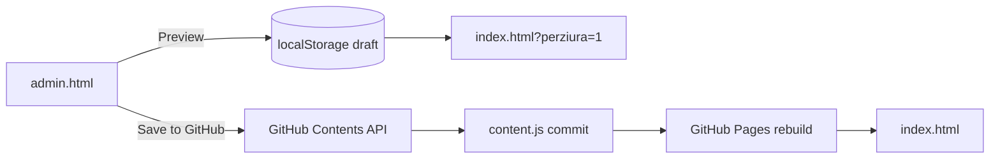

<div align="center">

# 🧦 Little socks

**A crochet pattern for kids' socks in three sizes, with a browser-based content manager that publishes straight to GitHub.**

[](https://j3ws3r.github.io/projektas/)


[View the pattern](https://j3ws3r.github.io/projektas/) · [Open the content manager](https://j3ws3r.github.io/projektas/admin.html) · [Report an issue](https://github.com/j3ws3r/projektas/issues)

</div>

---

## Contents

- [About](#about)
- [Features](#features)
- [Project structure](#project-structure)
- [How it works](#how-it-works)
- [Running locally](#running-locally)
- [Managing content](#managing-content)
  - [Editing and previewing](#editing-and-previewing)
  - [Publishing to GitHub](#publishing-to-github)
  - [Pattern variables](#pattern-variables)
- [Content reference](#content-reference)
- [Deployment](#deployment)
- [Credits](#credits)

## About

The public page walks a beginner through crocheting socks for children aged 1 to 10. The socks are worked in the round from the toe up in single crochet, with the heel added at the end. Readers pick a size once and every stitch count in the pattern updates to match.

The site is two static HTML files and one data file. There is no framework, no bundler and no server. All editable content lives in `content.js` and is managed through `admin.html`, which commits changes to this repository through the GitHub API.

## Features

| Public page (`index.html`) | Content manager (`admin.html`) |
| :-- | :-- |
| Size picker for S, M and L that rewrites stitch counts in place | Form-based editor for every section of the page |
| Remembers the chosen size between visits | Reorder steps, sizes and supplies with ↑ / ↓ controls |
| Gauge guide and abbreviation list | Live preview in a new tab before anything is published |
| Recommended supplies split into essentials and extras | Validation for duplicate variable keys and bad links |
| Light and dark themes that follow the system setting | One-click save to GitHub as a separate commit, or download `content.js` |
| Responsive layout, no external scripts | Reload the latest published content from GitHub |

## Project structure

```text
projektas/
├── index.html    # Public page: renders the pattern from content.js
├── content.js    # All page content: text, sizes, variables, steps and supplies
├── admin.html    # Content manager: edit, preview and publish content.js
├── .nojekyll     # Tells GitHub Pages to serve files as they are
└── README.md
```

## How it works



`content.js` assigns a single object to `window.SITE_CONTENT`. `index.html` loads it and builds the page in the browser. When the page is opened with `?perziura=1` it reads the unsaved draft from `localStorage` instead and shows a preview banner.

## Running locally

No install is needed. Clone the repository and serve the folder with any static server:

```bash
git clone https://github.com/j3ws3r/projektas.git
cd projektas
python3 -m http.server 8000
```

Then open <http://localhost:8000> for the pattern and <http://localhost:8000/admin.html> for the content manager.

> [!TIP]
> Opening `index.html` directly from disk also works, but a local server keeps the preview flow behaving the same way it does on GitHub Pages.

## Managing content

### Editing and previewing

1. Open `admin.html`.
2. Edit the text, sizes, variables, steps or supplies in the panels.
3. Click **Preview** to open the page with your draft in a new tab.

Drafts are kept in the browser's `localStorage`, so you can close the tab and pick up where you left off. Nothing is published until you save.

### Publishing to GitHub

Saving needs a GitHub fine-grained personal access token limited to this repository.

<details>
<summary><b>Creating the token</b></summary>
<br>

1. Go to **Settings → Developer settings → Personal access tokens → Fine-grained tokens**.
2. Click **Generate new token**.
3. Under **Repository access**, choose **Only select repositories** and pick `j3ws3r/projektas`.
4. Under **Repository permissions**, set **Contents** to **Read and write**.
5. Generate the token and copy it.

</details>

Paste the token into the **GitHub** panel of the content manager, then click **Save to GitHub**. Each save becomes its own commit that updates `content.js` on the `main` branch. The owner, repository, branch, file path and commit message can be changed in the same panel.

> [!IMPORTANT]
> The token is stored in `sessionStorage` only. It is cleared when the tab closes and is sent nowhere except `api.github.com`.

> [!NOTE]
> If someone else changed `content.js` since you loaded it, the save is rejected with a conflict. Use **Load latest content from GitHub** to fetch the latest version and apply your edits again.

### Pattern variables

Pattern text can contain placeholders in curly braces. The page swaps each one for the value of the selected size.

```text
Keep going until you have {n} stitches. This takes {toeRounds} rounds.
```

| Key | Meaning | S | M | L |
| :-- | :-- | :-: | :-: | :-: |
| `{n}` | Stitches per round | 30 | 36 | 42 |
| `{toeRounds}` | Toe rounds | 5 | 6 | 7 |
| `{heelSpace}` | Space left for the heel | 4 cm | 4.5 cm | 5 cm |
| `{half}` | Half the stitches | 15 | 18 | 21 |
| `{leg}` | Leg length | 4 cm | 5 cm | 6 cm |
| `{cuff}` | Cuff rounds | 4 | 5 | 6 |
| `{decStart}` | First heel decrease spacing | 3 | 4 | 5 |

Values are set in the **Variables** panel. Keys may only contain letters, numbers and underscores and must be unique.

## Content reference

<details>
<summary><b>Top-level keys in <code>content.js</code></b></summary>
<br>

| Key | Type | Description |
| :-- | :-- | :-- |
| `site` | object | Page title, brand, hero text, fact chips and footer |
| `prep` | object | "Before you start" section: sizing advice, gauge and abbreviations |
| `defaultSize` | string | Size shown on a reader's first visit, for example `"M"` |
| `sizes` | array | Each size's `id`, `age`, `foot` length and `yarn` amount |
| `variables` | array | Placeholder `key`, `label` and a value per size |
| `instructions` | object | Pattern title, lead, `steps` and a closing tip |
| `productsSection` | object | Title and intro for the supplies section |
| `products` | array | Supplies with `tag` (`must` or `nice`), `name`, `description`, `spec`, `price` and `url` |
| `kit` | object | Starter kit box: title, text and item list |

</details>

<details>
<summary><b>Pattern step blocks</b></summary>
<br>

Each step in `instructions.steps` has a `title` and a list of `blocks`. A block is one of two types:

| Type | Renders as | Example |
| :-- | :-- | :-- |
| `row` | A highlighted round or row instruction | `Round 2: inc in every stitch (12)` |
| `p` | A normal paragraph | `Work 1 sc in each stitch until...` |

```js
{"title": "Leg", "blocks": [
  {"type": "p", "text": "Work sc in a spiral for {leg}."}
]}
```

</details>

## Deployment

The site is served by GitHub Pages from the root of the `main` branch. Any push to `main`, including saves from the content manager, triggers a rebuild that usually goes live within a minute.

> [!WARNING]
> `admin.html` is public like every other file in the repository. It is marked `noindex`, but its only protection is the access token. Never paste a token with wider permissions than this one repository.

## Credits

This project is built with [Claude](https://claude.ai), the AI assistant made by Anthropic. Claude helps write and improve the code, plan the architecture and draft the documentation. A person makes the final decisions and reviews every change.
